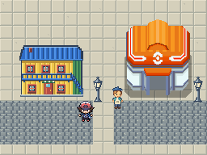

# La Boca · calibración 01

Primera entrega de calle, arquitectura y personaje. El detalle se concentra en siluetas, pelo, ropa, ventanas y uniones de materiales. La pintora usa como referencia de densidad la hoja de personaje aportada para este encargo. Los colores planos y los contornos mantienen la lectura junto a los recursos actuales.

**Estado: archivos finales de esta calibración, pendientes de integración.** Las imágenes de contexto son montajes; esta entrega no fue ejecutada ni comprobada en Godot. No incorpora nuevas especies.

[Montaje ampliado 4×](Previews/montaje_la_boca_4x.png) · [Cuatro vistas de la pintora](Previews/pintora_vistas_4x.png)

## Archivos

Los [PNG](../../../../Assets/Produccion/Barrios/la_boca/v01/) conservan una grilla nativa. Las [fuentes editables y la paleta](../../../../ArteFuente/la_boca_calibracion_01/v01/) están separadas de las imágenes de contexto.

| Pieza | Lienzo | Contenido |
|---|---:|---|
| `conventillo_amarillo.png` | 80×64 | Fachada, alero, balcón, escalera y acceso |
| `conventillo_amarillo_cuerpo.png` | 80×64 | Cuerpo del edificio, con el mismo origen |
| `conventillo_amarillo_techo.png` | 80×64 | Techo y alero, con el mismo origen |
| `farol.png` | 14×31 | Hierro oscuro, vidrio claro y pie escalonado |
| `pintora.png` | 32×128 | Cuatro poses de 32×32: abajo, arriba, izquierda y derecha |
| `suelo_urbano.png` | 128×112 | Atlas de celdas 16×16: 47 conexiones de vereda, adoquín y cuatro variantes |
| `adoquin.png` | 16×16 | Centro de calzada independiente |
| `vereda.png` | 16×16 | Centro de vereda independiente |

Son cuatro familias principales; las capas y los centros de suelo también se exportan por separado. No contar los recortes del atlas como edificios u objetos diferentes.

## Formatos y uso

Todos los PNG son RGBA. Las entidades usan alfa binario, sin suavizado. Los centros de suelo son opacos; las últimas cuatro celdas del atlas están vacías. La paleta completa tiene 50 colores: pintora, 21; conventillo, 20; farol, 6; suelo, 9. Algunos colores son compartidos.

La pintora tiene una pose por dirección, sin animación de caminar. Las cuatro vistas apoyan en `y=31` dentro de su celda. El conventillo completo coincide píxel por píxel con la composición de cuerpo y techo. Usar la versión completa **o** las dos capas.

La revisión incluye tamaño nativo y ampliación 4×, cuatro direcciones, alfa, anclas, repetición de materiales y uniones. Las conexiones de terreno conservan continuidad de materiales entre celdas vecinas en ambas direcciones. El atlas incluye esquinas exteriores e interiores. Los ejemplos de [esquina](Previews/esquina_4x.png), [T](Previews/union_t_4x.png) y [cruce](Previews/cruce_4x.png) muestran su composición.

El [manifest](manifest.json) contiene tamaños, paletas, recortes, anclas, puertas, huellas y rutas. Los máximos de los rectángulos `bbox_visible_px` son exclusivos. La [ficha de integración](integracion.md) describe las asignaciones necesarias.

## Referencias y créditos

El conventillo es un diseño ficticio para el juego; no representa un inmueble histórico concreto. El farol es una simplificación de mobiliario barrial, con un solo fanal para conservar la escala existente.

- [Calle Museo Caminito, Turismo Buenos Aires](https://turismo.buenosaires.gob.ar/es/otros-establecimientos/calle-museo-caminito): contexto de chapa pintada, balcones y adoquines.
- [Fotografía general de Caminito](https://turismo.buenosaires.gob.ar/sites/turismo/files/calle-museo-caminito-dic2025-1500x610.jpg): se observaron los paños de color, balcones y detalles de los faroles.
- [Vista aérea de Caminito](https://turismo.buenosaires.gob.ar/sites/turismo/files/2caminito-aerea-1500x610.jpg): relación entre frentes, techos y espacio de calle.

Fuentes consultadas el 18 de octubre de 2026. Las fotos sirven de referencia; no se incorporaron sus píxeles. El protagonista y el Centro Pokémon del montaje son recursos existentes del proyecto y conservan los [créditos originales](../../../../CREDITOS.md). No forman parte de los assets nuevos ni se redistribuyen en esta carpeta de PNG.

Esta calibración establece formatos y detalle para los siguientes lotes; no constituye el kit completo de La Boca ni las otras siete ciudades.
