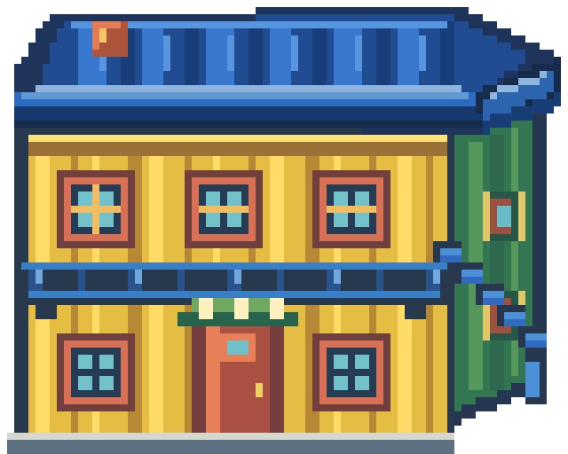

# La Boca · calibración 02

Ajuste visual de dos piezas de la calibración 01. La pintora mantiene el diseño aprobado de boina azul, coleta castaña, camiseta turquesa y delantal crema; el conventillo ahora muestra el plano superior del techo, el espesor del alero y un lateral verde con ventanas, manteniendo su fachada de chapa, balcón y escalera.

La hoja de la pintora usa las cuatro vistas de 32×32 en orden abajo, arriba, izquierda y derecha. El conventillo conserva el lienzo de 80×64 y los anclajes y colisión existentes descritos en [integración](integracion.md). El PNG completo y las dos capas comparten tamaño y origen. Esta revisión sigue pendiente de integración y revisión dentro del motor.

Fuentes editables: [SVG del conventillo y XPM de la pintora](../../../../ArteFuente/la_boca_calibracion_01/v02/). PNG finales: [carpeta v02](../../../../Assets/Produccion/Barrios/la_boca/v02/).

