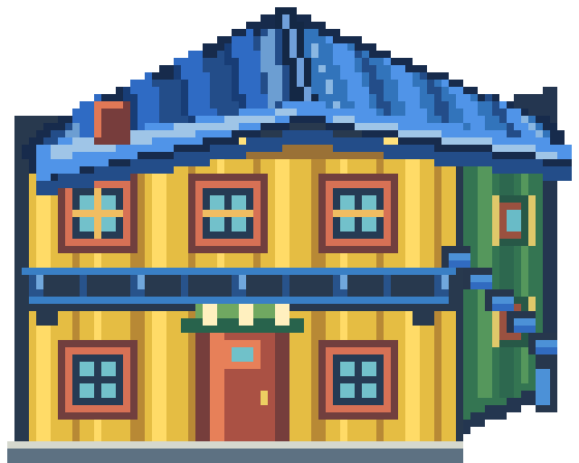

# La Boca · calibración 03

**Esta entrega fue reemplazada por [calibración 04](../la_boca_calibracion_04/README.md).** El PNG del edificio y la hoja de personaje descritos aquí ya no son los activos.

Rediseño del conventillo con una cumbrera que retrocede hacia el fondo y dos faldones de techo con volumen, inspirado en las casas de cuarta generación que compartiste. Se conserva la fachada de chapa, el balcón corrido, la escalera y el formato de píxel nativo.

La pintora ahora usa la hoja aprobada de cuatro direcciones y está colocada como NPC interactivo frente al conventillo en el mapa. Su acabado queda documentado como referencia para diseñar los próximos personajes, con ropa y siluetas propias para cada uno.

La textura activa es `Assets/Overworld/LaBoca/conventillo_amarillo.png`; el sprite activo está en `Assets/Personajes/npc/LaBoca/pintora.png` y lo recorta `Recursos/Personajes/boca_pintora.tres`. Las colisiones y los anclajes existentes se mantienen. El proyecto todavía necesita reimportar las texturas al abrirse en Godot.

Fuentes editables y PNG versionados: [SVG v03](../../../../ArteFuente/la_boca_calibracion_01/v03/conventillo_amarillo.svg) · [recursos de producción v03](../../../../Assets/Produccion/Barrios/la_boca/v03/). Las versiones anteriores se conservan.
