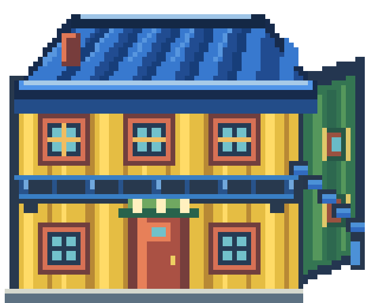

# La Boca · calibración 05

**Reemplazada por [calibración 04](../la_boca_calibracion_04/README.md)**, que coincide con la imagen elegida por el usuario.

Esta versión corrige la dirección de la profundidad del conventillo. El plano del techo retrocede hacia el fondo por el eje vertical de la imagen, centrado sobre la fachada como en el Centro Pokémon. Los bordes convergen de forma simétrica; no hay una cumbrera que se fugue hacia un lateral. El alero frontal queda horizontal, por encima de las ventanas.

La textura activa del juego es `Assets/Overworld/LaBoca/conventillo_amarillo.png`. La fuente editable es [SVG v05](../../../../ArteFuente/la_boca_calibracion_01/v05/conventillo_amarillo.svg); los PNG completos y las capas de cuerpo y techo están en [Assets/Produccion/Barrios/la_boca/v05](../../../../Assets/Produccion/Barrios/la_boca/v05/).

Se conserva el lienzo de 80×64 y el anclaje existente de `ConventilloAmarilloExterior.tscn`. La textura está instalada en la ruta del juego; Godot debe reimportarla al abrir el proyecto. El motor no estuvo disponible para ejecutar la escena en esta sesión.
