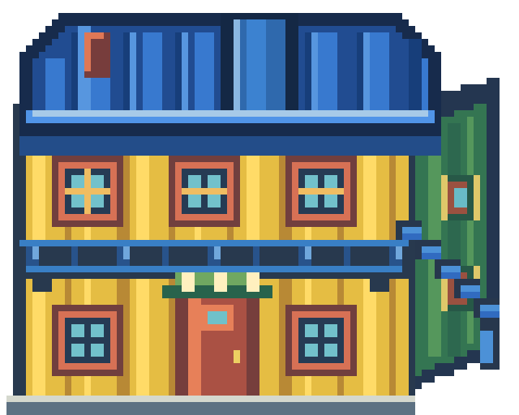

# La Boca · calibración 06

**Esta variante fue descartada a favor de [calibración 04](../la_boca_calibracion_04/README.md)**, que coincide con la imagen elegida por el usuario.

El techo toma el volumen rectangular del esquema de Excalidraw. La profundidad corre hacia el fondo de la casa por el eje vertical de la imagen; una franja elevada central conecta ese fondo con el alero frontal. Las alas izquierda y derecha quedan simétricas a ambos lados, sin fuga ni extensión hacia un costado.

La textura activa es `Assets/Overworld/LaBoca/conventillo_amarillo.png`, en el mismo lienzo y anclaje de 80×64. Fuente editable: [SVG v06](../../../../ArteFuente/la_boca_calibracion_01/v06/conventillo_amarillo.svg). Los PNG del edificio completo y de sus capas están en [Assets/Produccion/Barrios/la_boca/v06](../../../../Assets/Produccion/Barrios/la_boca/v06/).

Godot reimportará la textura al abrir el proyecto; el motor no estuvo disponible para ejecutar la escena en esta sesión.
