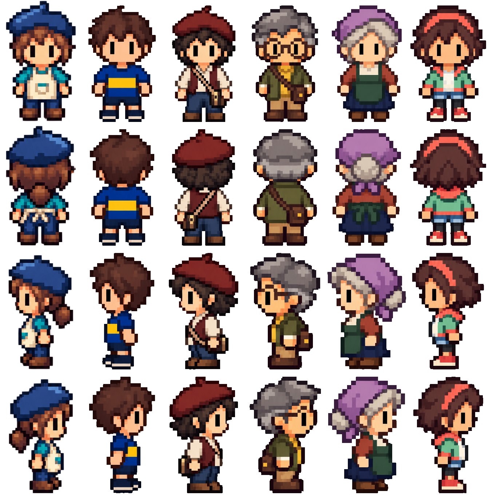

# La Boca: NPC con acabado simple

Rediseño del hincha, músico, guía, tendera y Chica Ana a partir de la pintora enviada como referencia. La pintora existente coincide con esa referencia y se conserva sin cambios. Cada persona mantiene un vestuario reconocible; se simplifican texturas, costuras, accesorios y rasgos pequeños.

## Integración

- Se reemplazan los cinco PNG activos `Assets/Personajes/npc/LaBoca/*_detallada.png` correspondientes a esos personajes.
- Contrato conservado: 224×1360 px, cuatro celdas de 224×340, orden abajo, arriba, izquierda, derecha.
- Pies alineados en y=335 de cada celda, centro horizontal x=112. Alfa binario transparente, sin fondo pintado.
- Los recursos `boca_*.tres` y los nodos de `Mapa.tscn` siguen usando sus rutas, recortes y escala 0,09 actuales. Diálogos, colisiones y lógica intactos.
- Las fuentes generadas están en `ArteFuente/la_boca_npcs_simples_v01/`. Las entregas históricas de producción se conservan como versiones anteriores.

## Procedencia y validación

Arte generado con la herramienta integrada image_gen, una solicitud por personaje, usando la pintora como referencia de estilo y cada hoja anterior como referencia de identidad. No es dibujo manual ni una fuente vectorial editable. `prompts.json` registra las instrucciones completas. El empaquetado técnico se realizó con ImageMagick: separación por bandas de alfa, umbral de alfa al 50% para eliminar residuos casi transparentes, recorte, ajuste nearest a un máximo de 216×320, centrado y alineación del pie en celdas de 224×340.

Se inspeccionaron visualmente las veinte poses y la comparación conjunta. Comprobaciones automáticas: dimensiones, alfa 0/255, cuatro poses no vacías sin cortes, pies alineados y regiones de los SpriteFrames dentro del PNG.

Estado: archivos conectados a los recursos existentes; pendiente de prueba visual en Godot, que no está instalado en este entorno. La comparación es una hoja de revisión, no una captura del motor. En Godot, abrir `Escenas/Mapa.tscn`, revisar el tamaño junto al protagonista y hablar a cada personaje desde sus cuatro lados.
