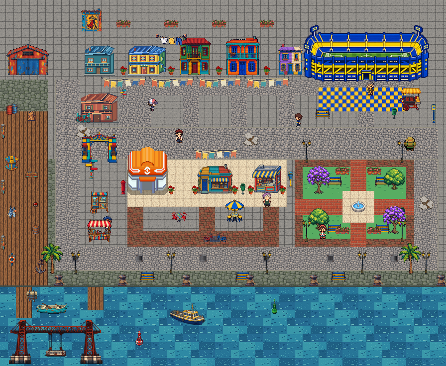

# Rediseño del primer barrio de La Boca

Distribución basada en el [croquis del usuario](croquis_referencia.png) y sus nuevos assets de `Assets/Overworld/`.

## Distribución

| Sector | Ubicación |
| --- | --- |
| Viviendas | Cinco casas al norte y una sobre el lateral oeste |
| Bombonera | Esquina noreste, con explanada azul y amarilla |
| Centro Pokémon, café y kiosco | Bloque central, de izquierda a derecha |
| Plaza | Este del bloque central, con fuente, árboles y bancos |
| Puerto | Lateral oeste, con galpón, madera, redes y amarras |
| Riachuelo | Borde sur, con dos muelles, embarcaciones y puente |

Las calles conectan las viviendas, la Bombonera, los locales, la plaza y el paseo costero. La ambientación incluye banderines, ropa tendida, puestos de artesanías y pinturas, macetas, farolas, bicicletas, papeleras y un carrito de choripán.

## Edición

- `Escenas/Mapa.tscn`: personajes, puertas, Centro Pokémon y Bombonera.
- `Escenas/DecoracionLaBoca.tscn`: fachadas, mobiliario, vegetación y colisiones; cada objeto se puede mover en el editor.
- `Escenas/TerrenoLaBoca.tscn`: suelo guardado como tiles nativos de Godot, sobre una cuadrícula de 16 px y un mapa de 896 × 736 px.
- `Scripts/la_boca_terreno.gd`: permite reconstruir el terreno con el botón del inspector de `Suelo`. Reconstruir reemplaza las ediciones manuales de sus tiles.

La cámara conserva su zoom y la resolución de juego de 256 × 192. Las imágenes `camara_*.png` muestran esa vista en distintos sectores. Los archivos fuente proporcionados se mantienen intactos; los tres objetos de mayor resolución se ajustan mediante la escala del sprite.

## Revisión local — 20 de octubre de 2026

- Importación y apertura final del proyecto con Godot 4.7.2, sin errores de carga ni de scripts.
- Revisión visual de la vista general y de casas, Bombonera, locales, plaza y puerto con la cámara de juego.
- Comprobación de recorridos usando la forma física del jugador y barrido entre celdas: 1509 celdas conectadas al inicio. Accesibles las puertas, los NPC, el objeto recogible, la plaza y ambos muelles. El agua está bloqueada por colisiones.
- Comprobación de cuatro transiciones completas de ida y vuelta: casa, Centro Pokémon y ambas salidas a la zona de entrenamiento. Los retornos colocan al jugador en sus nuevos marcadores.
- `git diff --check` sin errores.

Al cerrar los procesos de revisión, Godot emite avisos de cuatro instancias y dos recursos todavía en uso. No impidieron la carga, los recorridos ni las transiciones.
